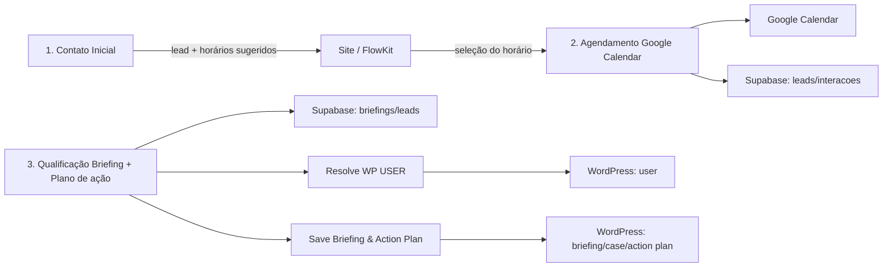

# Arquitetura — Whoworks Funnel

## Propósito e estado do repositório

Automação do funil de contato do site Whoworks: capta leads, oferece horários para reunião, registra a confirmação, recebe e qualifica um briefing pós-reunião e publica briefing/plano de ação no WordPress.

O repositório contém cinco exports JSON do n8n em `exports/`, um README e documentação inicial. Não foram encontrados testes, configuração de ambiente ou workflows auxiliares de CI/deploy. Os exports indicam que os workflows estão ativos no ambiente de origem, mas isso não comprova o estado de execução atual da instância n8n. O diretório `.git` presente no workspace não contém metadados reconhecidos pelo Git; portanto, o versionamento ainda precisa ser inicializado/conectado a um remoto pela equipe.

## Stack e estilo

- **Orquestração:** n8n, com workflows principais acionados por webhooks e subworkflows invocados via `Execute Workflow`.
- **Persistência operacional:** Supabase, nas tabelas `leads`, `interacoes` e `briefings`.
- **Agendamento:** Google Calendar e API REST do site WordPress para criação do agendamento.
- **Qualificação/conteúdo:** nós LangChain/OpenAI, parser estruturado e geração de HTML/Markdown.
- **Comunicação:** envio de e-mail e notificação via Telegram.
- **WordPress:** endpoints REST `wp/v2/briefing` e rotas `flowkit/v1` para usuários, casos e planos de ação.

O n8n coordena o fluxo; dados e efeitos externos são gravados nos serviços acima. Os exports dependem de credenciais e valores de configuração mantidos na instância n8n, que não devem ser versionados neste repositório.

## Inventário e fluxo principal



| Arquivo | Responsabilidade observada | Entrada e efeitos principais |
|---|---|---|
| `exports/Website Funil_ 1. Contato Inicial.json` | Recebe contato, normaliza os dados, consulta agenda via ferramenta do Google Calendar, sugere horários com agente estruturado, solicita criação de agendamento ao site e envia e-mail/notificação. Registra lead e interação no Supabase. | Webhook POST. Dados normalizados incluem nome, e-mail, empresa, serviço/interesse, cargo, telefone, preferência de agenda e briefing/problema. Chama `POST /wp-json/flowkit/v1/agendamento/criar` no `URL_BASE` configurado. |
| `exports/Website Funil 2_ Agendamento Google Calendar.json` | Recebe a seleção de horário, cria evento no Google Calendar e atualiza lead no Supabase; o nó de atualização da interação está desativado. Envia notificação Telegram. | Webhook POST. O processamento usa `agendamento_id`, `slot_id`, `start_time` e `end_time`; `agendamento_id` localiza o lead pela referência de agendamento. Confirmar payload e resposta do site. |
| `exports/Website Funil 3_ Qualificação Briefing + Plano de ação.json` | Recebe briefing completo, registra submissão e atualiza lead, gera plano, resolve/cria usuário WordPress e chama o subworkflow de gravação. Há nós de histórico/e-mail desconectados ou desativados no export. | Webhook POST. Campos observados incluem `lead-id`, `briefing-type`, `localizacao`, `faturamento-anual`, `consent-term`, `segmento`, `tamanho-empresa`, `nome-completo`, `email`, `telefone`, `empresa`, `cargo`, `linkedin`, `observacoes-finais` e `agendar-reuniao`. Persiste em `briefings` e `leads`; conexões para histórico de `interacoes` não estão completas. |
| `exports/[SubWorkflow] WF3_ Resolve WP USER.json` | Recebe e-mail/nome/ambiente, consulta se usuário existe no site e cria usuário quando necessário; retorna ID. | Subworkflow chamado pelo Workflow 3. Usa `GET .../wp-json/flowkit/v1/user-exists` e `POST .../wp-json/flowkit/v1/user-create`. |
| `exports/[SubWorkflow] WF3_ Save Briefing & Action Plan.json` | Gera relatório/conteúdo e cria briefing, caso e plano de ação no WordPress. | Recebe títulos/conteúdo, ID/e-mail/nome do usuário e ambiente. Usa `POST .../wp-json/wp/v2/briefing`, `.../wp-json/flowkit/v1/cases` e `.../wp-json/flowkit/v1/action-plans`. |

## Contratos e dependências a confirmar

- Os contratos acima foram inferidos dos mapeamentos entre nós nos exports; não há schema OpenAPI, validação de payload externa ou documentação do formulário/site no repositório.
- `URL_BASE`, credenciais do Supabase, Google Calendar, OpenAI, SMTP, Telegram e WordPress são dependências externas. Seus valores e segredos devem ficar em credenciais/configurações do n8n; documentar apenas nomes lógicos e ambientes, nunca tokens ou URLs privadas.
- O site precisa fornecer/consumir corretamente os três webhooks e as rotas `flowkit/v1`; confirmar autenticação, respostas, timeouts, retries e política de idempotência.
- Confirmar as tabelas/colunas e chaves do Supabase com o schema real. Os exports fazem referência a `leads`, `interacoes` e `briefings`, mas não incluem migrations/schema.
- Validar timezone, formato de horários, expiração e unicidade de agendamento entre WordPress e Google Calendar.
- Revisar nós e payloads de criação do WordPress: há valores fixos de exemplo visíveis no export de criação do caso/plano (autor, dados de lead e horários ilustrativos), que precisam ser verificados antes de importação/uso em produção.
- Revisar a consulta de interações no Workflow 3: o filtro exportado para `lead_id` aparenta conter valor fixo (`48`), diferente dos filtros dinâmicos do fluxo; confirmar se é dado de teste ou erro.
- Conferir a relação entre o caminho de erro de criação do agendamento e o salvamento do lead no Workflow 1, e definir resposta HTTP para os consumidores dos webhooks.
- Os nomes exibidos nos nós de chamada e os nomes atuais dos subworkflows não coincidem integralmente; conferir os IDs referenciados na instância-alvo antes de importar/ativar.

## Organização atual do repositório

Estrutura atual, mantendo os nomes originais dos exports:

```text
README.md
docs/
  architecture.md
  workflows/
    index.md
exports/
  *.json
```

O inventário inicial está em `docs/workflows/index.md`. Se runbooks operacionais forem adicionados, criar `docs/runbooks/` e registrar instância/versão de origem de cada export. Manter cada workflow documentado com trigger, payload, nós/serviços, dados persistidos, falhas/retries e procedimento de validação.

## Manutenção, segurança e ciclo de vida

1. Exportar workflows pela interface/API oficial do n8n e revisar o diff JSON antes de salvar. Remover dados de execução/pin data e valores sensíveis ou específicos de produção quando aplicável.
2. Versionar apenas exports e documentação necessários. Não commitar credenciais, tokens, chaves, cookies, dados pessoais de leads, payloads de produção ou URLs de webhook completos.
3. Usar credenciais do n8n e variáveis de ambiente/configuração separadas por ambiente. Validar explicitamente `URL_BASE`, calendário, tabelas e IDs referenciados antes de importar.
4. Importar primeiro em ambiente de desenvolvimento/staging, reconectar credenciais, conferir IDs de subworkflow e executar casos de sucesso/erro com dados sintéticos. Ativar produção pelo processo documentado pela equipe; não ativar a partir de um JSON sem revisão.
5. Antes de alterações, exportar uma cópia da versão ativa. Registrar data, instância e versão do n8n compatível; preservar o export anterior para rollback.
6. Definir retenção e controle de acesso às execuções: payloads contêm dados pessoais e briefing potencialmente confidencial. Limitar acesso e evitar anexar execuções reais a issues ou commits.

## Convenções para contribuições

- Preservar os nomes atuais dos arquivos até que a equipe aprove uma renomeação; nomes e referências da instância n8n podem ser distintos.
- Uma mudança de automação deve indicar arquivo afetado, motivo, dependências externas, risco de duplicação/efeitos colaterais e forma de rollback.
- Fazer diffs pequenos e validar JSON sintaticamente antes de importar. Não editar manualmente IDs internos de workflow/nó ou referências de credencial sem necessidade documentada.
- Manter contratos de entrada/saída sincronizados com a documentação do site WordPress e schema do Supabase.

## Pendências para completar a preparação

- Confirmar instâncias/ambientes n8n, versões e política de ativação/deploy.
- Confirmar schema Supabase, contratos HTTP do site e proprietário das credenciais.
- Corrigir/verificar os pontos destacados na seção de contratos com o responsável por n8n/WordPress.
- Inicializar/conectar o repositório Git; o diretório `.git` atual é inválido/incompleto.
- Confirmar se a estrutura `exports/` está alinhada com o processo de publicação da equipe.
- Adicionar validação automatizada de JSON e uma lista de verificação de revisão/importação quando o processo de deploy estiver definido.
